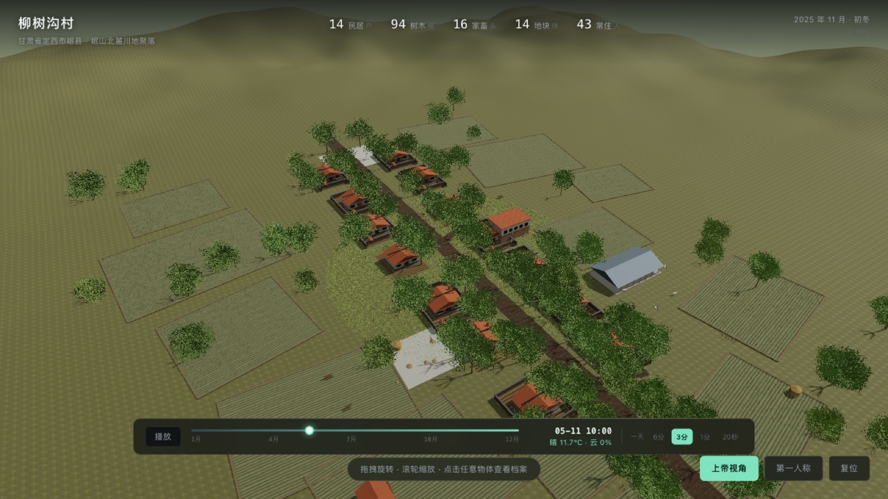
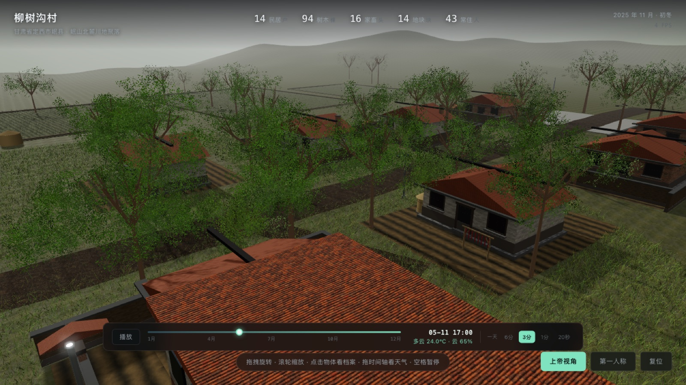

# 柳树沟村 · 数字村落

甘肃定西岷县风格的三维虚拟村庄，用 Three.js 写的可漫游数字孪生演示：上帝视角看全村、点开每栋房子看档案、切第一人称走进去，时间和天气由岷县 2025 年全年的真实气象记录驱动。



## 它是什么

- **虚构村落**：14 户民居、94 棵树、16 头牲畜、14 块耕地、13 处公共设施、9 件院落物件，共 **160 个可点击对象**，每个都有独立档案卡。
- **真实天气**：岷县 2025 年全年 **8760 小时**气象数据（Open-Meteo），云量、降水、气温、风速都来自真实记录，不是随机天气。
- **连续昼夜**：太阳位置按赤纬 + 时角逐帧解算，日出日落是一条平滑曲线，不是按小时跳格。
- **可拖时间轴**：一年 35040 格（15 分钟/格），四档流速（一天 = 6 分 / 3 分 / 1 分 / 20 秒），默认 3 分钟一天。
- **桌面端离线**：全部资源内联进单个 HTML，双击即开，不联网、不用服务器。



## 快速开始

### 方式一：下载成品（推荐）

到仓库的 **Releases** 页面下载最新版本的 `Liushugou-Village-x.y.zip`，解压后双击 `柳树沟村.html`。

### 方式二：从源码构建

需要 Node 18+。

```bash
npm install
node tools/build-standalone.mjs     # 生成 柳树沟村.html
```

本地调试（源码版走 ES Module，必须经 HTTP）：

```bash
npx serve .        # 或 python3 -m http.server 8099
# 打开 http://localhost:8099/index.html
```

## 操作

| 操作 | 方式 |
|---|---|
| 旋转 / 缩放 | 左键拖动 / 滚轮（触控板双指） |
| 看档案 | 点击任意物体，点空白处关闭 |
| 第一人称 | `F` 进入，`Esc` 退出，`WASD` 移动，`Shift` 加速 |
| 暂停时间 | `空格` |
| 调时间 | 拖底部时间条，或切右侧速度档 |

调试参数：`?day=131&hour=10&pause=1`、`?speed=0..3`、`?noao=1`、`?nopost=1`、`?qa=1`，完整列表见《管理员手册》。

## 目录

```
js/          源码：main / world / environment / climate / controls / ui / data / textures / assets
css/         界面样式
data/        岷县 2025 逐小时气象（8760 条）
assets/      HDRI 与 PBR 扫描贴图
vendor/      three.js r160 及后处理
tools/       构建、打包、发布、截图与自检脚本
docs/        四份项目文档（Word + Markdown 源稿）
```

## 文档

| 文档 | 内容 |
|---|---|
| [管理员手册](docs/01-管理员手册.docx) | 怎么用、怎么演示、出问题怎么修 |
| [项目手册](docs/02-项目手册.docx) | 做了什么、怎么做的、技术方案 |
| [项目目录](docs/03-项目目录.docx) | 每个文件在哪、干什么 |
| [项目日志](docs/04-项目日志.docx) | 开发过程、踩过的坑、问题台账 |

## 版本与发布

每个版本对应一个 git tag 与一条 GitHub Release，Release 里附可直接运行的 zip。

```bash
./tools/release.sh 1.1 "新增村民日常动线"
```

脚本会：更新 `VERSION` → 追加 `CHANGELOG.md` → 构建单文件版与交付 zip → 提交 → 打 tag → 推送 → （装了 `gh` 时）创建 Release 并上传 zip。

第一次把仓库发布到 GitHub、以及不装命令行工具时的发布流程，见 [发布指南](docs/发布指南.md)。

只打包不发布：

```bash
./tools/package.sh          # 产物在 dist/
```

## 数据与素材

- 气象：Open-Meteo 历史档案（CC BY 4.0），岷县 2025-01-01 ~ 12-31。
- 贴图与环境光：Poly Haven（CC0）。
- 村落、住户、牲畜数据：全部虚构，仅用于演示。

## 已知限制

只支持桌面浏览器；没有村民角色；建筑为构件拼装而非高模；无音频；气象为 2025 历史数据，暂不支持实时天气。
